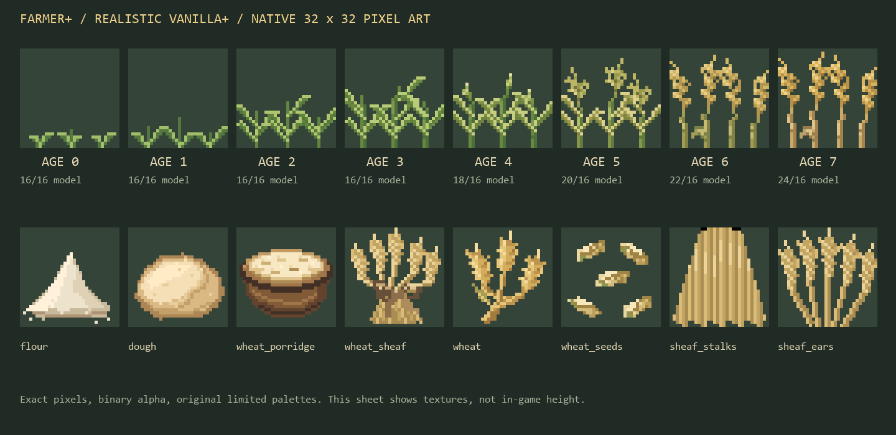

# Farmer+

[English](README.md) | **Português**

Uma reformulação do sistema de plantações do Minecraft com cara de vanilla. O Farmer+ adiciona plantações, comidas, ingredientes e tipos de solo que parecem ter sempre feito parte do jogo — nada de simulador de fazenda nem menus novos para aprender, só uma versão mais profunda do que você já conhece.

| | |
|---|---|
| Minecraft | 26.3 |
| Loaders | Fabric, NeoForge, Forge |
| Java | 25 |
| Lado | Cliente e servidor |
| Licença | MIT |

## Princípios

- **Vanilla em primeiro lugar.** Toda adição precisa parecer, soar e funcionar como algo que a Mojang lançaria. Receitas, texturas e progressão seguem as convenções do vanilla.
- **Levíssimo.** Dois mixins minúsculos, sem lógica por tick, sem reflexão. O conteúdo é registrado uma vez na inicialização e o comportamento vem de componentes de dados, tags e JSON do próprio vanilla. Cada jar tem cerca de 160 KB, quase tudo arte em 32×32 e modelos de bloco.
- **Feito para modpacks.** Os ingredientes usam as tags de convenção `c:` (`c:flours/wheat`, `c:doughs/wheat`, …), então farinha ou massa de outros mods funciona nas receitas do Farmer+ e vice-versa.
- **Todos os loaders.** Uma única base de código gera Fabric, NeoForge e Forge, e é atualizada sempre que o Minecraft ou algum loader lança versão nova.

## Conteúdo

### Atualização do trigo (0.1.0)

| Item | Como obter | Observações |
|---|---|---|
| Farinha | 1 trigo (bancada) | Aceita em qualquer receita que use `c:flours/wheat` |
| Massa | 3 farinhas + balde de água → 3 massas | Asse na fornalha, defumador ou fogueira para virar pão |
| Mingau de Trigo | 2 trigos + açúcar + balde de leite + tigela | Recupera 7 de fome e devolve a tigela |
| Feixe de Trigo | 4 trigos em volta de 1 linha | Bloco decorativo, reduz dano de queda em 80% como o fardo de feno, quebra mais rápido com enxada, pode ir na composteira |

O pão vanilla (3 trigos) continua igual — a massa é um caminho alternativo que recompensa quem cozinha.

O próprio trigo ganha uma **reformulação visual Vanilla+ realista**: arte original em 32×32 para os oito estágios, quatro variações naturais por estágio, trigo maduro mais alto e trigo e sementes redesenhados. As mecânicas continuam vanilla. O visual também existe como resource pack avulso (`./gradlew wheatVisualPack`). Veja [docs/wheat-visuals.pt-BR.md](docs/wheat-visuals.pt-BR.md).



### Pisoteio de plantações

Andar pela plantação entorta as plantas, correr ou passar a cavalo deita elas, e os caminhos que você usa sempre ficam esmagados no solo — geometria de verdade, com caules inclinados e quebrados caindo na direção em que você andou. Plantas entortadas se recuperam com o tempo; as esmagadas só dão sementes. Pular na plantação amassa em vez de destruir a planta e a terra arada. Agache para andar com cuidado. Ligue/desligue com `/gamerule farmerplus:crop_trampling` e `/gamerule farmerplus:mob_crop_trampling`. Veja [docs/trampling.pt-BR.md](docs/trampling.pt-BR.md).

## Instalação

1. Instale o loader de sua preferência para o Minecraft 26.3.
2. Somente Fabric: instale também o [Fabric API](https://modrinth.com/mod/fabric-api).
3. Coloque o `farmerplus-<loader>-26.3-<versão>.jar` correspondente na pasta `mods`.

## Compilando o código

```bash
./gradlew build
```

Os jars ficam em `fabric/build/libs`, `neoforge/build/libs` e `forge/build/libs`.

Abrir um cliente de desenvolvimento:

```bash
./gradlew :neoforge:runClient
```

A mesma tarefa existe para `:fabric` e `:forge`.

## Documentação

| Tema | English | Português |
|---|---|---|
| Arquitetura e como adicionar conteúdo | [docs/architecture.md](docs/architecture.md) | [docs/architecture.pt-BR.md](docs/architecture.pt-BR.md) |
| Pipeline de arte (texturas, Blockbench) | [docs/art-pipeline.md](docs/art-pipeline.md) | [docs/art-pipeline.pt-BR.md](docs/art-pipeline.pt-BR.md) |
| Visual do trigo | [docs/wheat-visuals.md](docs/wheat-visuals.md) | [docs/wheat-visuals.pt-BR.md](docs/wheat-visuals.pt-BR.md) |
| Pisoteio de plantações | [docs/trampling.md](docs/trampling.md) | [docs/trampling.pt-BR.md](docs/trampling.pt-BR.md) |
| Atualizando Minecraft e loaders | [docs/updating.md](docs/updating.md) | [docs/updating.pt-BR.md](docs/updating.pt-BR.md) |
| Como contribuir | [CONTRIBUTING.md](CONTRIBUTING.md) | [CONTRIBUTING.pt-BR.md](CONTRIBUTING.pt-BR.md) |
| Histórico de mudanças | [CHANGELOG.md](CHANGELOG.md) | [CHANGELOG.pt-BR.md](CHANGELOG.pt-BR.md) |

## Idiomas

Inglês (`en_us`) e português do Brasil (`pt_br`). Todo nome novo precisa ser adicionado aos dois arquivos em `common/src/main/resources/assets/farmerplus/lang/`.

## Licença

Código e assets sob a [Licença MIT](LICENSE).
