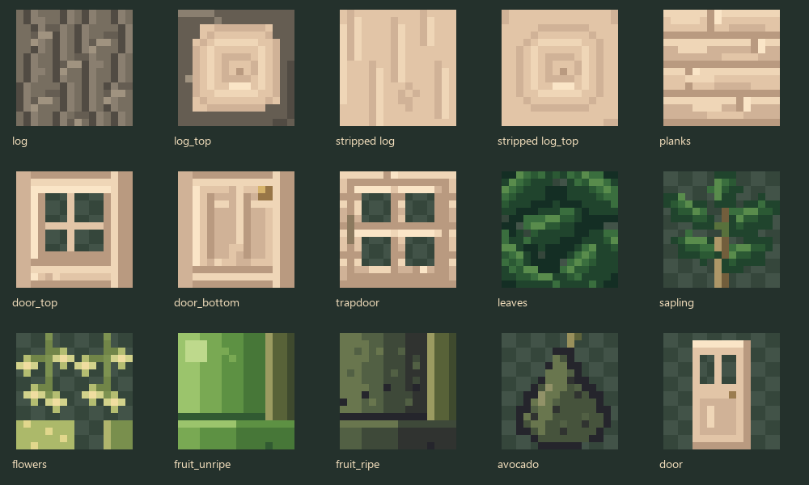
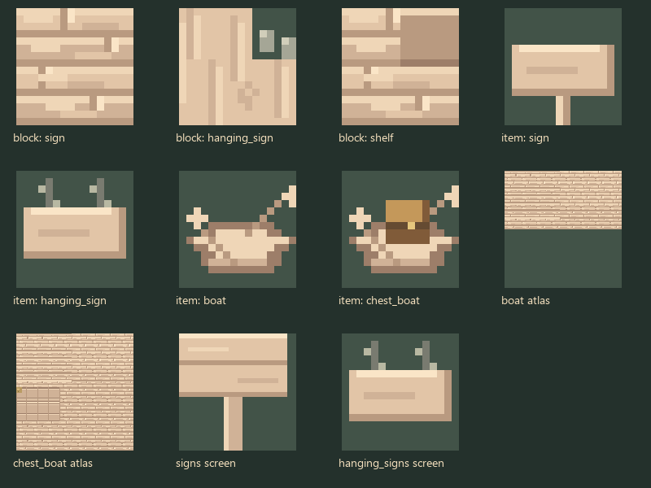
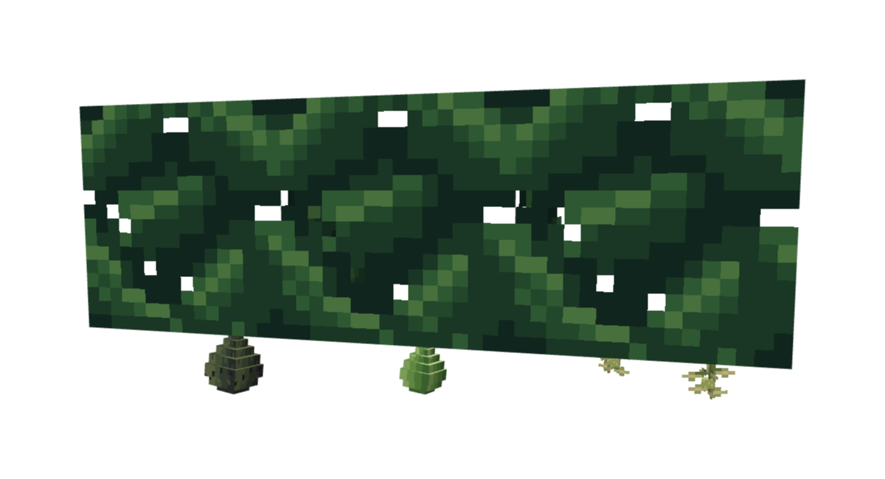
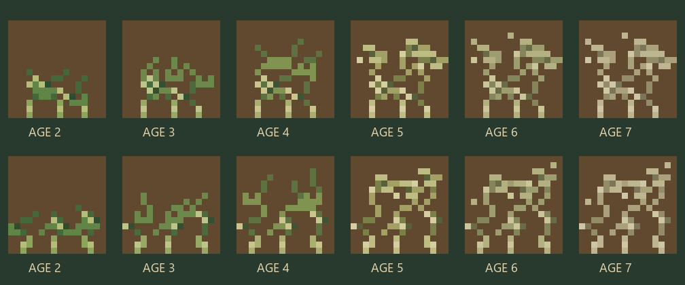
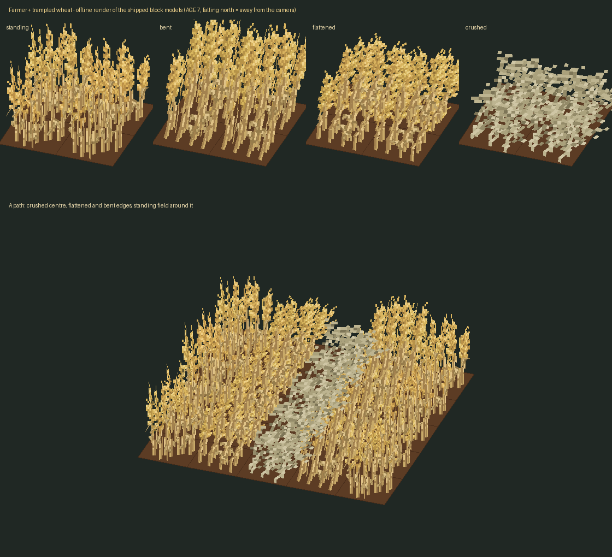

# Avocado and crushed wheat art

**English** | [Português](avocado-visuals.pt-BR.md)

Art tasks 0005 and 0002 replace the provisional images in place. Twenty-six avocado images and twelve crushed wheat sprites now use original hard-pixel artwork. Block and item textures are 16×16. Boat entity atlases and sign screens keep their required vanilla layout dimensions, as specified by task 0005.

## Tree and wood

Grey-brown bark has short irregular fissures and small plates. Cut ends and stripped logs expose creamy, slightly pink wood. Planks, door, lattice trapdoor, signs, shelf and boats share that warm palette. Leaves use large dark-green lanceolate clusters with small transparent gaps and lighter midribs; the sapling has five large leaves. Unripe skins are smooth green, while ripe skins have dark green/purple shadows and sparse pebbled highlights. The fruit item has a pear silhouette and a short stalk.

## Hanging models

The existing multipart leaf blockstate and all resource names are preserved. Each overlay is a Java Block/Item model exported through the Blockbench MCP server, saved in `art/blockbench/avocado_leaves_<stage>.bbmodel` with an embedded 16×16 atlas.

| Overlay | Elements | Vertical bounds after rotation | Arrangement |
|---|---:|---|---|
| `avocado_leaves_flowers` | 8 | −3.30…0 | Two small branching panicles with solid stalks and florets |
| `avocado_leaves_unripe` | 8 | −4.94…0 | One smaller green pear, seven connected body sections and one stalk |
| `avocado_leaves_ripe` | 8 | −6.08…0 | One larger dark pear, seven connected body sections and one stalk |

One fruit per overlay leaves room for a gradual narrow neck, broad lower belly and smaller rounded base within the eight-element budget. The sections share a slight lean and continuous side UV heights. This replaces the task's initial two-fruit box suggestion while retaining its permitted one-fruit arrangement and performance limit. Every rotated vertex stays within X/Z=0…16 and Y=−8…0. Flowers remain flowers rather than prematurely showing fruit.

## Crushed wheat

All twelve AGE 2–7 base/alternate textures were drawn as distinct broken stalk arrangements. Short snapped stubs occupy the bottom rows. Kinked culms, torn leaf ends, partial ears and loose mature kernels use bruised greens transitioning to dusty, muted straw. No soil or mud is painted into the sprites. Native 16×16 pixel coverage is about 14–27%, keeping roughly 73–86% of each sprite open; field previews were used to avoid a solid carpet after the four model planes overlap.

The existing 48 trampled models and blockstate geometry are unchanged. `art/trampled_wheat.py` now delegates AGE 2–7 crushed pixels to `art/crushed_pixels.py`, so regenerating the models preserves the final art. AGE 0–1 images are unchanged.

## Reproduction and checks

1. Run `python art/avocado_pixels.py` and `python art/avocado_wood_pixels.py` for the avocado textures and model inputs.
2. With Blockbench open, call `exportAvocado(root)` from `art/export_avocado.js` through MCP. The native sources and final exported JSON are saved together.
3. Run `python art/crushed_pixels.py`. The trampling generator also uses this authoring function when rebuilding.
4. `previewAvocado(root)` in `art/preview_avocado.js` renders the leaf overlay comparison through MCP; `python art/preview_trampled_wheat.py` renders the shipped trampled models offline.
5. Run `./gradlew build` and `python art/validate_wheat_art.py`.

Build and the validator passed. Checks include native embedded texture equality, all rotated avocado vertices, element budgets, crushed transparency/variation and current asset bytes in all three loader jars. The MCP export report is `build/art/validation/avocado-blockbench.json`.

The canopy image is a Blockbench render and the wheat field is an offline model render. Manual inspection of a grown tree and repeated survival trampling inside Minecraft remains pending; the NeoForge resource-load report records loading separately in `build/art/validation/avocado-crushed-resource-load.json`.
