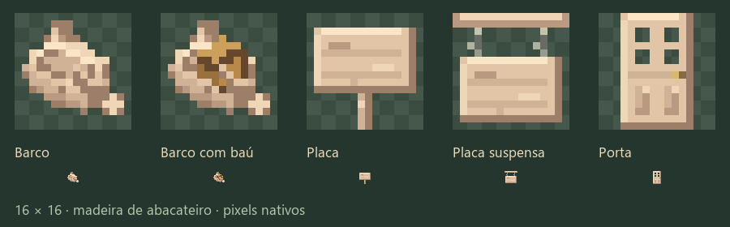

# Arte do abacateiro e do trigo esmagado

[English](avocado-visuals.md) | **Português**

As tarefas de arte 0005 e 0002 substituem as imagens provisórias nos mesmos caminhos. Vinte e seis imagens do abacateiro e doze sprites de trigo esmagado agora usam desenhos originais com pixels duros. Texturas de blocos e itens são 16×16. Os atlas das entidades dos barcos e as telas de placas mantêm as dimensões do layout vanilla, conforme a tarefa 0005.

## Árvore e madeira

A casca marrom-acinzentada tem fissuras curtas e irregulares e pequenas placas. Cortes de tora e madeira descascada mostram madeira creme levemente rosada. Tábuas, porta, alçapão vazado, placas, prateleira e barcos compartilham essa paleta quente. As folhas usam grupos alongados originais em 16×16 nativos, com sombras verde-escuras mais suaves, nervuras centrais discretas, brilho ceroso moderado e pequenos espaços transparentes irregulares. O menor contraste nas bordas e as direções variadas mantêm a copa densa e compatível com o vanilla; a muda compartilha a nova paleta. A casca dos frutos verdes é lisa, enquanto os maduros têm sombras verde-escuras/arroxeadas e pequenos realces rugosos. O item tem silhueta de pera e cabinho curto.

## Refinamento dos ícones de inventário

Os sprites do barco e do barco com baú usam uma vista diagonal original, casco com interior legível, remos mais curtos integrados e baú sombreado. As placas têm mais profundidade na madeira, veios e suportes mais claros; o ícone da porta tem quatro vidros e dois painéis inferiores, acompanhando o bloco. Os cinco ícones mantêm a paleta creme do abacateiro, pixels nativos 16×16 e os mesmos caminhos. Os sprites vanilla foram vistos apenas como referência de estilo.

Rode `python art/avocado_wood_pixels.py --items-only` para regenerar esses cinco ícones e sua prévia sem reescrever texturas de bloco ou atlas de entidades.

## Modelos pendurados

O bloco de frutos pendurados usa os modelos de floração, fruto verde e fruto maduro abaixo. Cada um é um modelo Java Block/Item exportado pelo servidor MCP do Blockbench, salvo em `art/blockbench/avocado_fruit_<estágio>.bbmodel` com um atlas 16×16 embutido. Os modelos ocupam a metade superior do bloco separado de frutos, com os cabos alcançando as folhas acima.

| Sobreposição | Elementos | Limites verticais após rotação | Arranjo |
|---|---:|---|---|
| `avocado_fruit_flowering` | 8 | 12,70…16 | Dois pequenos cachos ramificados com cabos e flores sólidos |
| `avocado_fruit_unripe` | 8 | 9,82…16 | Uma pera verde menor, sete partes conectadas no corpo e um cabo |
| `avocado_fruit_ripe` | 8 | 8,34…16 | Uma pera escura maior, sete partes conectadas no corpo e um cabo |

Um fruto por modelo permite modelar gradualmente o pescoço fino, a barriga larga embaixo e a base menor arredondada dentro do limite de oito elementos. Os dois estágios de fruto agora são 65% mais largos e suas partes do corpo são 30% mais altas do que na primeira exportação; o cabo também engrossou, melhorando a leitura abaixo de um bloco inteiro de folhas. As partes compartilham uma leve inclinação e alturas contínuas de UV nas laterais. Isso substitui a sugestão inicial de duas frutas em caixas da tarefa, preservando sua opção de um fruto e o limite de desempenho. Todos os vértices rotacionados ficam dentro de X/Z=0…16 e Y=8…16 no bloco de frutos, equivalente a Y=−8…0 em relação às folhas acima. O estágio de floração continua mostrando flores.

## Trigo esmagado

As doze texturas AGE 2–7, base e alternate, foram desenhadas com arranjos diferentes de caules partidos. Tocos curtos quebrados ocupam as linhas inferiores. Caules dobrados, pontas de folhas rasgadas, espigas incompletas e grãos maduros soltos passam de verdes machucados para palha opaca e empoeirada. Os sprites não contêm terra nem lama. A cobertura dos pixels nativos em 16×16 fica em cerca de 14–27%, deixando aproximadamente 73–86% de cada sprite aberto; as prévias do campo ajudaram a evitar um tapete sólido quando os quatro planos do modelo se sobrepõem.

Os 48 modelos de trigo pisoteado e a geometria do blockstate continuam iguais. `art/trampled_wheat.py` agora delega os pixels esmagados AGE 2–7 a `art/crushed_pixels.py`, portanto regenerar os modelos preserva a arte final. A [revisão nativa do trigo](wheat-visuals.pt-BR.md#revisão-nativa-em-16x16) posterior também redesenha os sprites esmagados AGE 0–1 sem uso em 16×16.

## Reprodução e verificações

1. Rode `python art/avocado_pixels.py` e `python art/avocado_wood_pixels.py` para gerar as texturas e entradas dos modelos do abacateiro.
2. Com o Blockbench aberto, execute `exportAvocado(root)` de `art/export_avocado.js` pelo MCP. As fontes nativas e os JSONs finais são salvos juntos.
3. Rode `python art/crushed_pixels.py`. O gerador do pisoteio também usa essa função de desenho ao reconstruir.
4. `previewAvocado(root)` em `art/preview_avocado.js` renderiza a comparação das folhas pelo MCP; `python art/preview_trampled_wheat.py` renderiza offline os modelos distribuídos do trigo pisoteado.
5. Rode `./gradlew build` e `python art/validate_wheat_art.py`.

O build e o validador passaram. As verificações incluem igualdade das texturas nativas embutidas, todos os vértices rotacionados dos abacates, limites de elementos, transparência/variação do trigo esmagado e bytes atuais dos recursos nos jars dos três loaders. O relatório da exportação MCP fica em `build/art/validation/avocado-blockbench.json`.

A imagem das copas é uma renderização do Blockbench e o campo de trigo é uma renderização offline dos modelos. O build mais recente com os frutos maiores passou nas 19.188 verificações do validador, e o NeoForge carregou os modelos e texturas atuais sem avisos de modelo ou textura do Farmer+; os hashes dos recursos e o carregamento dos atlas estão em `build/art/validation/avocado-canopy-resource-load.json`. A inspeção manual de uma árvore crescida e do pisoteio repetido em sobrevivência dentro do Minecraft ainda está pendente.
