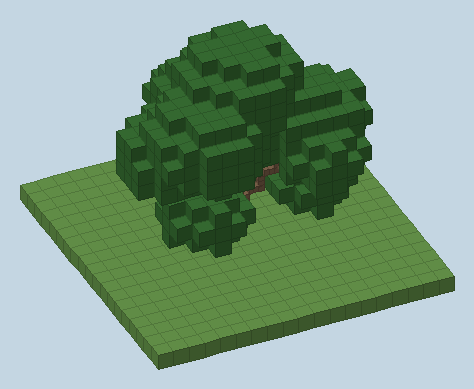
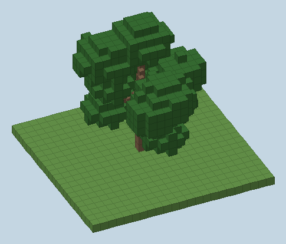
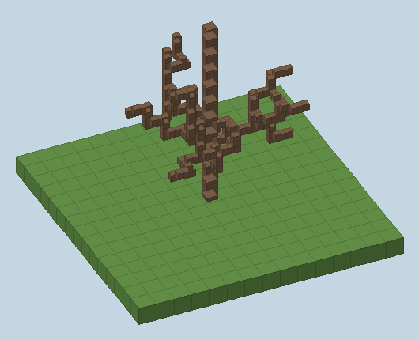

# Abacateiro

[English](avocado.md) | **Português**

Uma árvore frutífera em tamanho real, com um conjunto completo de madeira compatível com o vanilla. Abacateiros silvestres crescem nas selvas; suas folhas florescem, dão fruto e amadurecem várias e várias vezes.

## A árvore

Inspirada no abacateiro real (*Persea americana*): 9–20 m de altura, tronco curto que se divide baixo em 3–5 galhos-mestres e uma **copa redonda e muito densa**, muitas vezes tão larga quanto alta, com folhagem descendo baixo ([UF/IFAS](https://ask.ifas.ufl.edu/publication/ST435), [Missouri Botanical Garden](https://www.missouribotanicalgarden.org/PlantFinder/PlantFinderDetails.aspx?taxonid=281661), [World Agroforestry](https://apps.worldagroforestry.org/treedb/AFTPDFS/Persea_americana.PDF), [California Avocado Growers](https://www.californiaavocadogrowers.com/sites/default/files/2023-11/Architecture_of_Avo_Trees.pdf)).

| Árvore | Como conseguir | Altura | Copa | Tronco |
|---|---|---|---|---|
| Pomar | Uma muda | 10–13 blocos | ≈11–13 de largura | tronco de 10 px, 2–3 blocos livres |
| Silvestre | **Mudas em 2×2** (como a selva gigante) e nas selvas | 16–20 blocos | ≈15–17 de largura | 1 bloco de tora de largura, 3–5 blocos livres |

  

*Renderizações de árvores geradas pelo jogo e lidas do mundo salvo (`python art/preview_world_trees.py`).*

- **Madeira fina:** o tronco de um abacateiro de verdade tem só 30–60 cm de diâmetro e os galhos são ainda mais finos, então a árvore não é feita de toras inteiras. `avocado_trunk` (10 px) forma o tronco e o líder central, `avocado_branch` (6 px) forma todos os galhos, e os dois se conectam entre si, com toras e com o chão, como a planta do coro ou cercas (`core/wood/BranchBlock`). Só o gigante silvestre mantém uma `avocado_log` inteira na base.
- **Forma:** gerada por `farmerplus:broadleaf_tree` (`core/worldgen/BroadleafTreeFeature`): um líder central mais 3–5 galhos em ângulos aleatórios, um ramo lateral e um ramo baixo de "saia" em cada galho, e uma nuvem de folhas (elipsoide achatado com borda irregular) em volta de cada ponta. Toda folha fica a até 6 blocos de madeira, então nada apodrece.
- **Ajuste:** `data/farmerplus/worldgen/feature/avocado_tree.json` e `wild_avocado_tree.json` expõem os blocos `trunk`, `leader` e `branch` mais `height`, `trunk_height`, `limbs` e `crown_radius`; qualquer árvore de folha larga futura (manga, laranja…) reaproveita a mesma feature com o seu JSON.
- **Muda:** cresce na metade da velocidade vanilla (≈1 a cada 14 random ticks por estágio, luz 9+) e precisa de espaço para a copa inteira.
- **Árvores silvestres:** selva esparsa, selva e selva de bambu (`farmerplus:has_avocado_trees`), cerca de uma árvore a cada seis chunks.

## Frutificação

Só folhas **naturais** (colocadas pela árvore, não pelo jogador) dão fruto, e só as que têm **ar embaixo** e seguem um padrão espaçado, então uma árvore madura carrega uma quantidade realista de abacates (cerca de 5% das folhas).

| Estágio | `fruit` | Aparência | Próximo estágio |
|---|---|---|---|
| Folhas | 0 | Folhas comuns | Flores (≈1 a cada 24 random ticks) |
| Florindo | 1 | Florzinhas amarelo-esverdeadas embaixo das folhas | Fruto verde (≈1 em 8) |
| Verde | 2 | Abacates pequenos e verdes pendurados | Maduro (≈1 em 10) |
| Maduro | 3 | Abacates grandes e escuros pendurados | Cai sozinho (≈1 em 40) |

- **Colher:** botão direito nas folhas com fruto maduro dá um abacate; as folhas começam um novo ciclo, então a árvore frutifica muitas vezes.
- **Quebrar** folhas maduras também dá o abacate. As folhas dão mudas (5%) e **gravetos** como as de carvalho; tesoura ou Toque de Seda dão o bloco de folhas.
- Abacate: 4 de fome, 0,6 de saturação; aldeões comem; dá para compostar.

## Conjunto de madeira

`avocado_log`, `avocado_wood`, `stripped_avocado_log`, `stripped_avocado_wood`, `avocado_planks`, `avocado_stairs`, `avocado_slab`, `avocado_fence`, `avocado_fence_gate`, `avocado_door`, `avocado_trapdoor`, `avocado_pressure_plate`, `avocado_button`, `avocado_sign` (+ `avocado_wall_sign`), `avocado_hanging_sign` (+ `avocado_wall_hanging_sign`), `avocado_shelf`, `avocado_boat`, `avocado_chest_boat`, `avocado_leaves`, `avocado_sapling`.

A árvore em si é feita de dois blocos que se conectam e não fazem parte do conjunto vanilla: **`avocado_trunk`** dropa uma `avocado_log` e **`avocado_branch`** dropa 1–2 gravetos (toque suave mantém o bloco). Os dois são quebrados com machado, queimam como toras, mantêm as folhas vizinhas vivas (`minecraft:prevents_nearby_leaf_decay`) e podem ser colocados à mão para montar árvores próprias.

O conjunto espelha o carvalho em tudo que importa:

- **Tags:** toda tag vanilla que lista um bloco de carvalho lista o equivalente de abacateiro (`minecraft:logs_that_burn`, `minecraft:planks`, `minecraft:wooden_*`, `minecraft:fence_gates`, `minecraft:standing_signs`, `minecraft:wall_signs`, `minecraft:ceiling_hanging_signs`, `minecraft:wall_hanging_signs`, `minecraft:wooden_shelves`, `minecraft:boats`, `minecraft:chest_boats`, `minecraft:leaves`, `minecraft:saplings`, tipo de entidade `minecraft:boat`, …). Por isso as tábuas funcionam em **todas** as receitas de madeira — bancada, gravetos, baú, ferramentas, barril — e as toras funcionam em fogueira, carvão vegetal etc.
- **Receitas e loot:** iguais às do carvalho (tábuas a partir de `#farmerplus:avocado_logs`, madeira, escadas, lajes, cercas, portões, portas, alçapões, placas de pressão, botões, placas, placas suspensas, prateleiras, botes e botes com baú).
- **Descascar:** botão direito numa tora ou madeira com qualquer machado (`#minecraft:axes`). A própria tora cuida disso, sem sobrescrever nenhum arquivo compartilhado do vanilla.
- **Combustível:** mesmos tempos de queima do carvalho, pelo componente de item `minecraft:cooking_fuel`.
- **Fogo:** mesma inflamabilidade do carvalho (prateleiras queimam como as prateleiras vanilla). Fabric e Forge usam a tabela de fogo do vanilla (`FireBlockAccessor`); o NeoForge usa o data map dele (`data/neoforge/data_maps/block/flammable.json`).

### Placas, prateleira e botes

- **Tipo de madeira:** cada conjunto tem seu próprio `WoodType` e `BlockSetType`, chamados `farmerplus/<madeira>` (os sons são os padrões do carvalho). O nome só escolhe as telas de edição de placa: `minecraft:textures/gui/signs/farmerplus/<madeira>.png` e `minecraft:textures/gui/hanging_signs/farmerplus/<madeira>.png`.
- **Placas, placas suspensas e prateleira** usam os tipos de block entity vanilla `minecraft:sign`, `minecraft:hanging_sign` e `minecraft:shelf`. No 26.x o corpo delas é um modelo de bloco comum e os renderers vanilla só desenham o texto e os itens da prateleira, então nenhum renderer é registrado. Os blocos entram nos blocos válidos dos tipos vanilla pelo `BlockEntityBlocks`: o Fabric chama `addValidBlock`, o NeoForge usa o `BlockEntityTypeAddBlocksEvent` e o Forge (sem API) usa o `BlockEntityTypeAccessor` no common setup.
- **Botes:** `farmerplus:<madeira>_boat` e `farmerplus:<madeira>_chest_boat` são entidades `Boat`/`ChestBoat` vanilla com tipos de entidade próprios. O `client/BoatRendering` registra as camadas de modelo (`farmerplus:boat/<madeira>`, `farmerplus:chest_boat/<madeira>`) e os `BoatRenderer`s, chamado pelo entrypoint de cliente do Fabric, pelo `@Mod` de cliente do NeoForge e pelo `EntityRenderersEvent` do Forge. Texturas: `farmerplus:textures/entity/boat/<madeira>.png` e `entity/chest_boat/<madeira>.png`. Ejetores colocam os botes como os vanilla.

## Reaproveitando o conjunto de madeira

`WoodSets.register(nome, corDaMadeira, corDaCasca)` registra os 18 blocos de madeira, 18 itens e 2 tipos de entidade de bote, e adiciona o conjunto a `WoodSets.all()` (renderers dos botes e comportamentos de ejetor vêm automaticamente). `python tools/wood_set.py <nome>` gera blockstates, modelos, definições de item, loot tables, receitas, desbloqueios de receita e entradas de tag (de bloco, item e tipo de entidade) a partir dos moldes do carvalho vanilla. Folhas, muda, feature da árvore, texturas e traduções são próprias de cada árvore.

## Arte

A arte original foi implementada; veja a [tarefa de arte 0005](art-tasks/0005-avocado-tree.pt-BR.md).

As texturas originais e os modelos nativos dos frutos pendurados estão implementados; veja [o relatório da arte](avocado-visuals.pt-BR.md).
