# Banana visuals

**English** | [Português](banana-visuals.pt-BR.md)

The task 0006 placeholders are replaced in place. All twelve banana textures are manually authored 16×16 RGBA pixel grids with binary alpha. The forty Java block models, including the harvested stalk and diagonal dry leaf, have portable `.bbmodel` sources with embedded textures exported through Blockbench 5.2.2 over localhost MCP. Registry ids, existing model names and texture paths are preserved.

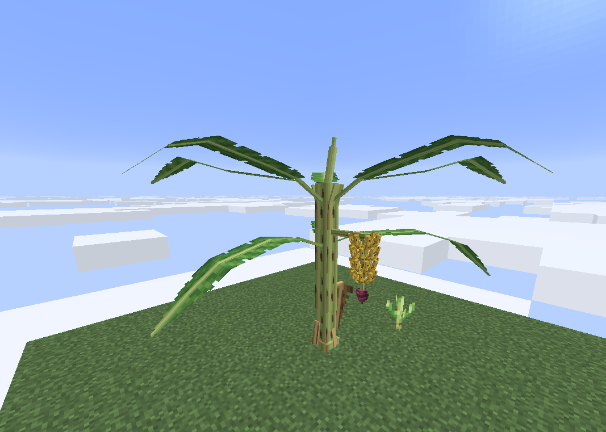

The user supplied this in-game screenshot during the first review. It predates the broader folded-leaf revision below. Its camera distance is unspecified; it does not certify the separate 20-block visibility check.

## Leaf refinement after review

The inspiration sheet is used for the broad paddle silhouette and curved midrib, rather than its painted detail. Living blades are now 16 model pixels wide instead of 13 (about 23% wider). The petiole is shorter, the rounded blade starts nearer the crown, and the narrowing is concentrated at the end of the leaf. Six successive longitudinal sections form each leaf's arch. Two halves fold down by 12° around the raised midrib, giving the blade a shallow roof profile and visible surfaces from below. Green pixel clusters use a softer gloss and finer vein contrast; the margin tears are asymmetric.

Each half has a thin 0.55-pixel section and a 0.65-pixel overlap beyond its nominal joins. End-cap UVs follow the taper so no detached green pixels appear outside the pointed silhouette. The centerline endpoints still coincide; the folded surfaces overlap through bends instead of requiring two differently inclined edges to occupy the same line. The validator samples both halves at every internal bend and block seam in all eight directions. Cardinal segments contain 7/6/6 elements; diagonal segments contain 7/12. All remain within the per-model budget. Folded diagonal panels use composed Euler rotations so their assembled midrib follows the exact north-east heading; the rib retains Y=-45°.

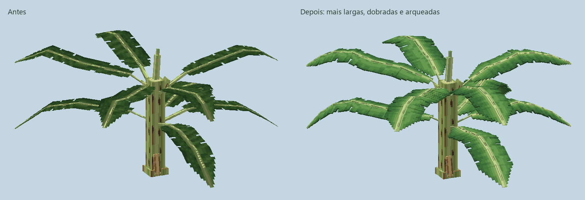
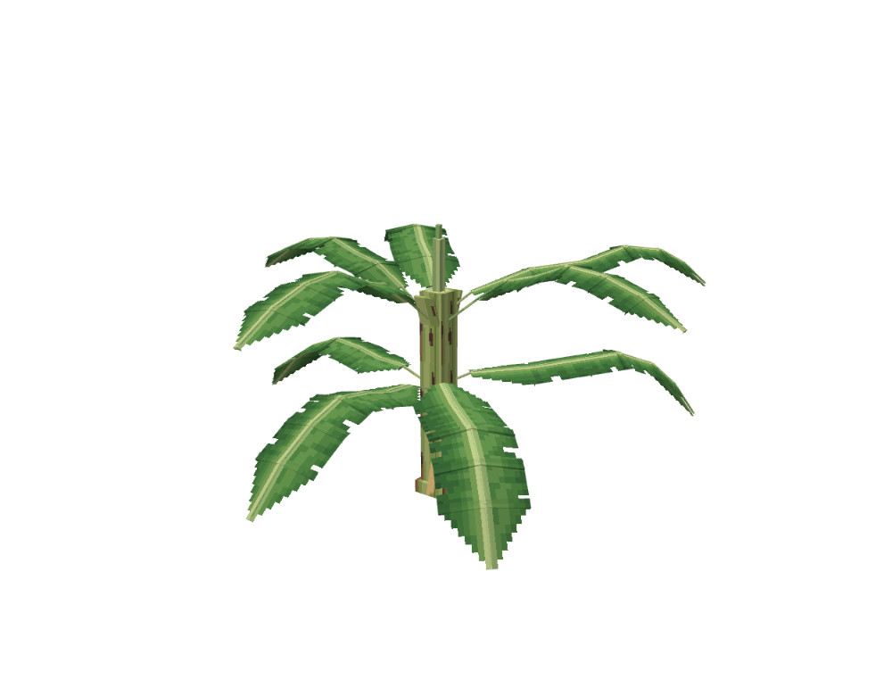
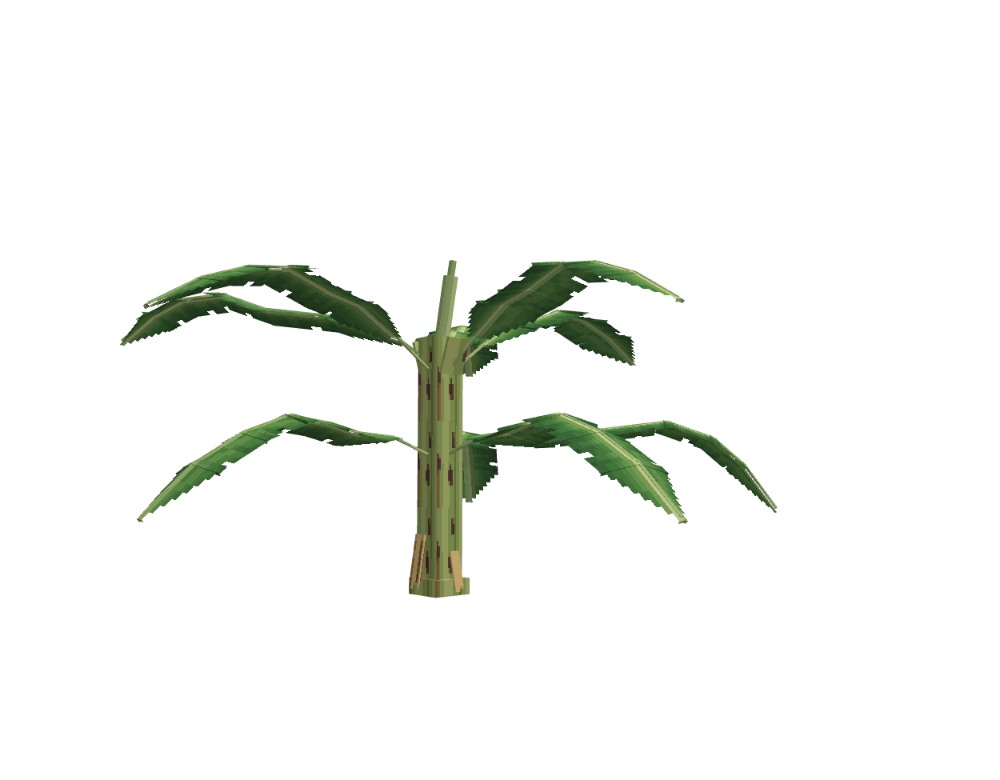

These are model previews, not new Minecraft screenshots. Existing fruit geometry is unchanged by this leaf revision.

## Anatomy and geometry

- The 6-pixel yellow-green pseudostem keeps x/z 5–11, with an 8-pixel basal flare, brown sheath blotches, peeling dry strips, open crown sheaths and a pale rolled cigar leaf.
- Young leaves rise and mature leaves droop. Each segment is authored from its actual attachment endpoints; the rotated length compensates for inclination. Cardinal and diagonal midribs meet exactly, while the folded blade skins overlap across their complete width.
- The leaf atlas keeps its midrib in columns 7–8. Tears cut inward from the margins along the veins; the pointed atlas narrows upward and the dead blade narrows downward. The sucker has three upright sword leaves.
- Each fruit is solid geometry: three overlapping, angled cuboids form an upward curve. Eight fruits surround the rachis per hand, with alternating hand orientations. The dark attachment cap faces inward toward the rachis, following the review request. The outer cap uses the fruit body colour.
- Bud has no fruit; flowering has two smaller hands; green and ripe have four full hands. The exposed rachis continues to a stepped, tapered maroon male bud.

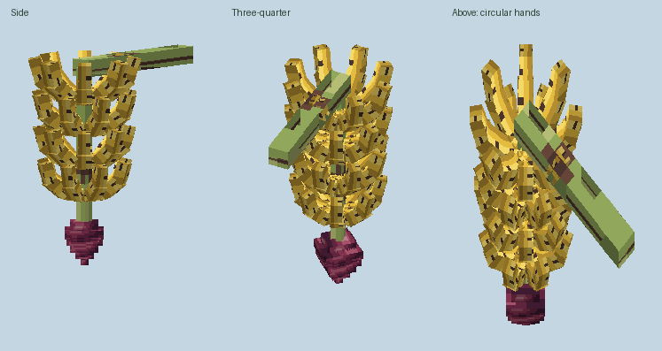
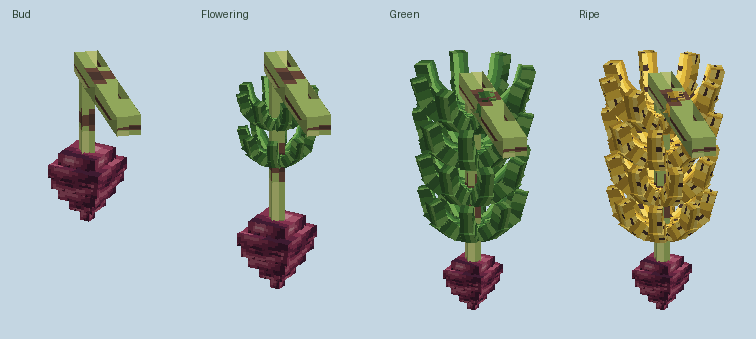
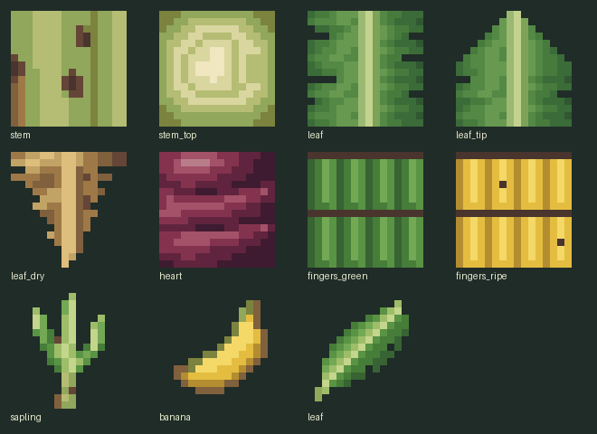

## Harvested bunch and shoulder display

The upright harvested bunch reuses the same eight ripe half-hands. Their geometry and positions have not changed. `validate_banana_carry.py` compares all eight geometric centres against `HAND_CENTERS`; the rounded Java coordinates still match, so no Java change is needed. All 32 facing/count combinations retain the core and exactly the expected remaining hands, removed from the bottom upward.

The stalk is now a six-element model with a narrow rachis inside the fruit, a reinforced grip, a small collar and two peeling fibres. The top remains at Y=19.5, preserving the hand attachment. A chamfered cap uses the original pale concentric cut texture across its entire top. The new original `banana_bunch_stalk.png` atlas uses seven hand-selected colours for longitudinal fibres, without altering the plant pseudostem texture. A full harvested bunch totals 102 elements across its nine parts.

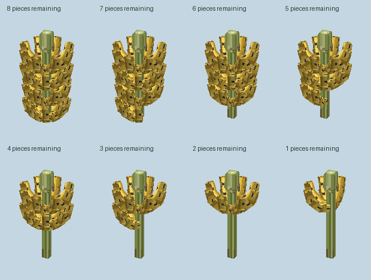
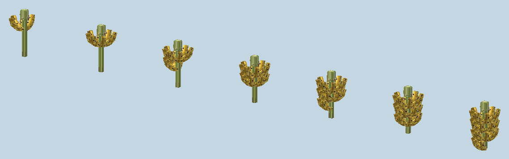

All nine `models/item/banana_bunch_*.json` files received the same display exported from the Blockbench display editor. After the user supplied the F5 image below, third-person rotation was refined to `[57,0,156]` with translation `[3.08642,3.5033,7.33115]`, preserving scale `[1.1,1.1,1.1]`. The bunch rotates around the centre of the held stub at (8,17.75,8.5), so the original hand attachment moves by less than 0.001 model pixel. This lowers the fruit body and moves it outward relative to the head without changing its size. The calculation follows Minecraft 26.3 `ItemTransform`'s XYZ quaternion order, verified from the local runtime class. The existing first-person shoulder placement is preserved. GUI vertical translation is refined to -1.25; ground translation is 3.2, matching the scaled base; fixed view rotates 15° around Y. The complete nine-part item was assembled in Blockbench for GUI/ground/fixed previews, rather than judging the isolated stub.

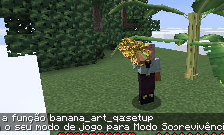

This image exposed overlap with the head and motivated the final inclination adjustment; it is not approval of that adjustment. A new F5 screenshot and first-person inspection are still required.

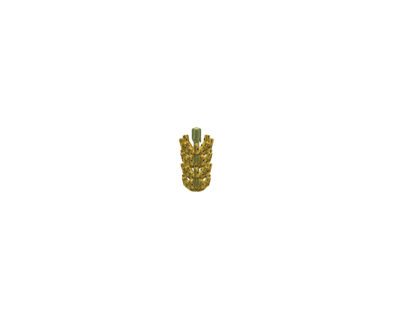
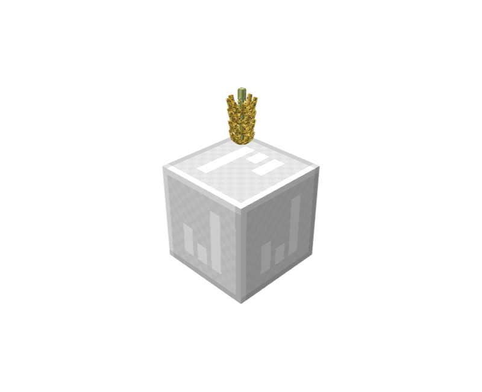
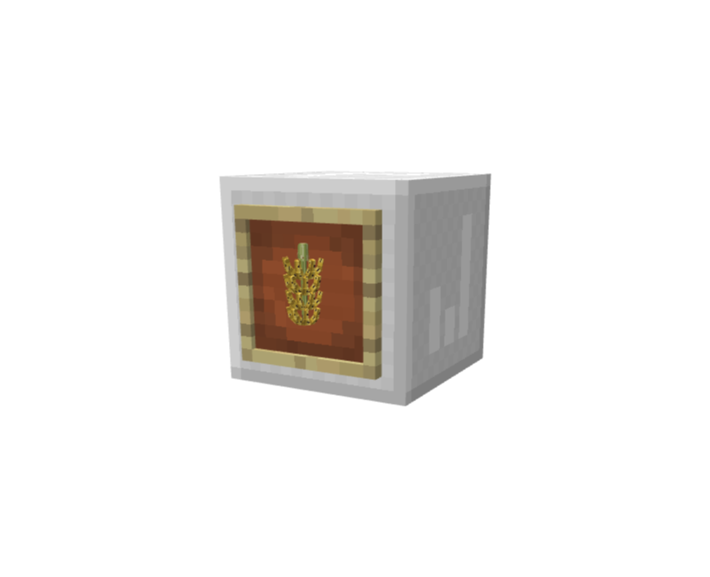

These previews verify framing in the editor. They do not certify the code-driven raised arm, shoulder contact in F5 or the screen crop in first person; those in-game checks remain pending because Computer Use was stopped with Escape, including after the subsequent request to continue.

## Dry diagonal attachment and hitboxes

The review found that diagonal dry states reused a cardinal model and left the petiole detached. The new `banana_leaf_dry_diagonal` keeps the existing names intact and places the root at the neighbouring stem centre (-8,24), with a -45° local yaw. Only the twelve dry diagonal variants (four directions × three segments) select this extra model. Living leaves and fruit pieces retain their positions.

`python art/banana_leaf_shapes.py` was rerun after the export and blockstate change. The generated asset now has 48 unique shapes and 72 state mappings, including the four dry diagonals. The preview sheet covers young, mature and dry in all eight directions.

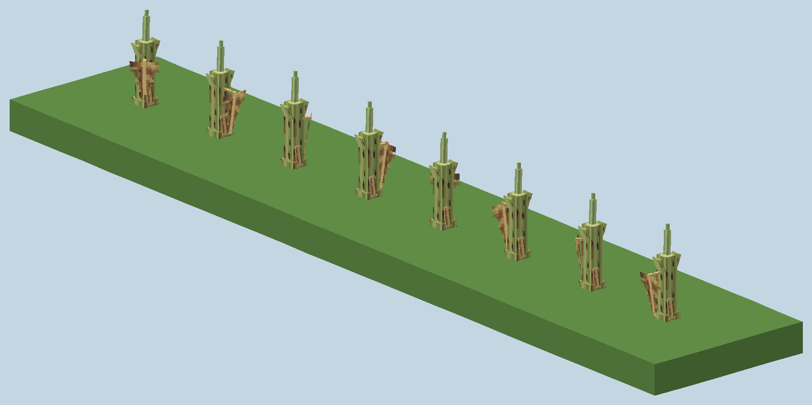

## Plant bunch geometry budget

Solid fruit uses additive vanilla blockstate `multipart` composition. Each half-hand is a separate 12-element Java model, and every original bunch model remains the peduncle/rachis/heart core. There are twenty additional hand model files and corresponding Blockbench sources; none of the existing names was replaced or renamed. No custom renderer, block entity or render tick handler is introduced.

| Stage | Core | Additional parts | Total elements per placed bunch |
|---|---:|---:|---:|
| Bud | 8 | 0 | 8 |
| Flowering | 8 | 4 × 12 | 56 |
| Green | 8 | 8 × 12 | 104 |
| Ripe | 8 | 8 × 12 | 104 |

The twelve-element limit is satisfied **per model**, not for the assembled bunch. This is a substantial geometry increase relative to the placeholder and must be considered during review. Dense orchards have not been profiled. Changing a ripe bunch to use only its core model would remove all fruit; preserve the multipart blockstate when integrating these assets.

## References and provenance

- [ProMusa: morphology of the banana plant](https://www.promusa.org/Morphology+of+banana+plant): overlapping pseudostem sheaths, leaf/rib anatomy, tears, cigar leaf, sword suckers, hands and male bud. Consulted 18 October 2026.
- [Kew POWO: Musa acuminata subsp. microcarpa](https://powo.science.kew.org/taxon/urn:lsid:ipni.org:names:60457966-2/general-information): botanical identity/context. Consulted 18 October 2026.
- The concept study below was made with the built-in image generation tool for palette and shape exploration. It is an AI illustration, not a botanical photograph or a texture source. No generated pixels were resized, traced or pasted into the shipped atlases; `art/banana_pixels.py` contains each manually selected pixel.
- Model previews are original software renders of repository assets. The in-game screenshot was supplied by the user. No third-party botanical photographs or Mojang textures are redistributed.

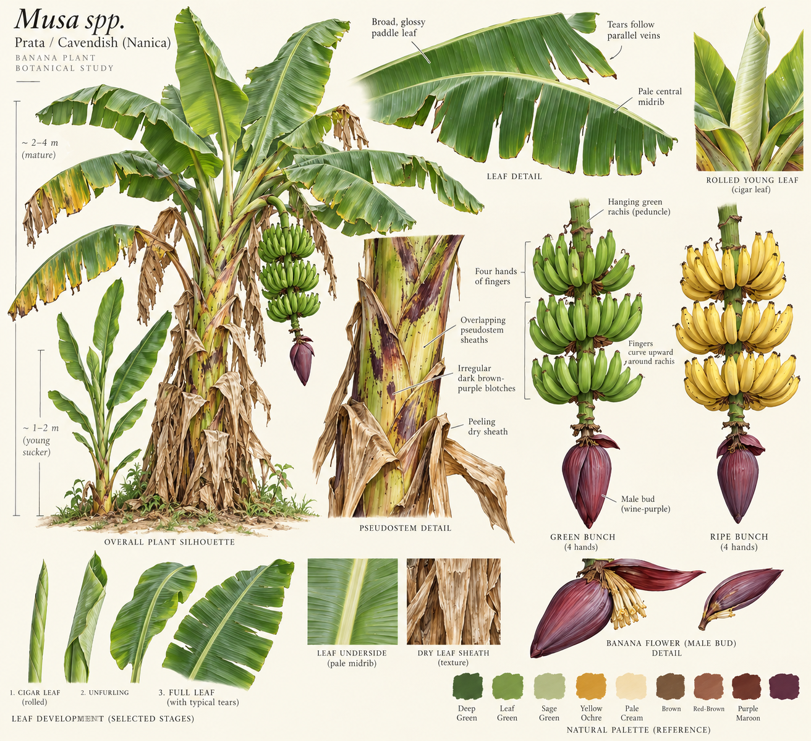

Generation prompt: “Create a botanical visual study sheet for an artist hand-drawing original Minecraft Vanilla+ banana plant textures. Not final game assets. Musa Prata / Cavendish Nanica: realistic yellow-green overlapping pseudostem sheaths, irregular dark brown-purple elongated blotches and peeling dry sheaths, broad glossy paddle leaves with pale central midrib and tears following parallel veins, straw dead leaves hanging, young narrow upright sword sucker, rolled pale cigar leaf at crown. Show separate detailed views of green and ripe bunches with FOUR hands of fingers distinctly curving UP around a hanging green rachis and a wine-purple tapered male bud below. Ivory background, daylight top-left, natural muted green / yellow ochre / cream / maroon swatches. Observational botanical concept painting with overall plant silhouette and anatomical closeups. No game screenshot, no Mojang textures, no pixel sprites. This image only informs shapes and palette; final sprites are manually authored at 16×16.”

## Reproduction

1. Run `python art/banana_pixels.py` to write the eleven hand-authored atlases and their nearest-neighbour contact sheet.
2. Run `python art/banana_models.py` to prepare the 38 geometry inputs and the bunch multipart blockstate.
3. With Blockbench open, call `exportBanana(root)` from `art/export_banana.js` through MCP. This saves the editable sources and exported Java JSON. It verifies preserved Euler angles and element counts.
4. Run `./gradlew build`, `python art/validate_wheat_art.py` and `python art/validate_banana_art.py`.
5. In the existing Fabric development server test world, set `gamerule minecraft:random_tick_speed 0`. Put grass platforms at y=199 around (100,100), (120,100), (140,100) and (160,100). Run `place feature farmerplus:banana_plant X 200 100` at the first three, and `place feature farmerplus:wild_banana_clump 160 200 100`. Save with `save-all flush`.
6. Run `python art/preview_banana.py` to regenerate the stage, angle, direction and saved-world sheets. The direction sheet is a controlled assembly; the generated-plant sheet reads actual saved blocks from the server world. This also prepares the block manifest used by `previewBananaLeaves(root)` in `art/preview_banana_blockbench.js`; call that function through MCP for the GPU previews above.
7. The original requested example also works: `python art/preview_world_models.py --box 35 45 35 45 199 207 --scale 34 --yaw 200 --tilt 0.3 --out docs/images/banana-plant.png`.

**Do not run `python art/banana_art.py`: it would overwrite the final models and multipart blockstate.**

To reproduce the harvested-bunch finish, run `python art/finish_banana_bunch.py`, then call `finishBananaCarry(root)` from `art/export_banana_carry.js` through MCP. The helper writes art inputs; Blockbench writes the final stalk/source and synchronizes display across the nine item models. `previewBananaCarry(root)` from `art/preview_banana_carry.js` generates the editor previews. If `art/banana_bunch_art.py` is needed to regenerate the harvested blockstate or composite item, reapply this finish afterwards: it otherwise restores the provisional stalk and default display values.

For diagonal dry leaves, run `python art/finish_banana_dry.py`, export `banana_leaf_dry_diagonal` using `exportBanana(root, ['banana_leaf_dry_diagonal'])`, then run `python art/banana_leaf_shapes.py`. Always regenerate shapes after changing any leaf model or the leaf blockstate. Run `python art/validate_banana_carry.py` alongside the existing validators.

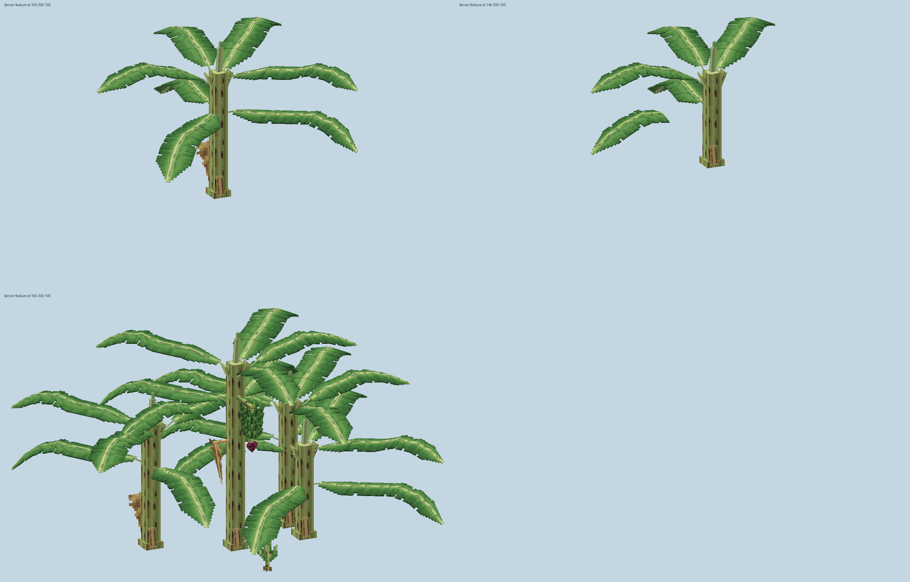
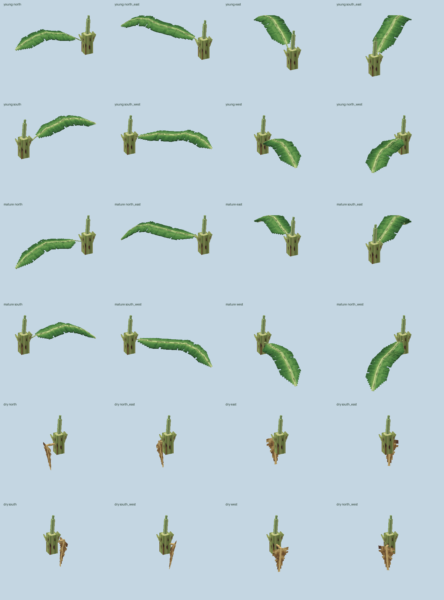

## Verification and limits

On 18 October 2026, the final art build passed. `validate_wheat_art.py` passed 24,557 checks with no errors; `validate_banana_art.py` passed 3,588 checks with no errors; `validate_banana_carry.py` passed 95 checks with no errors. The checks cover binary alpha, 16×16 RGBA, coordinates, UVs, embedded source pixels, all sixteen plant bunch stage/facing combinations, all 32 harvested facing/count combinations, shared displays, preserved grip position, dry attachments and identical shipped assets in the Fabric, NeoForge and Forge jars. All eight live-leaf directions occur in the saved-world fixtures. Eighty internal/block joint checks validate midrib endpoints and 640 folded-skin overlap samples. The largest midrib discrepancy is approximately 0.0000065 model pixels. Blockbench previews were inspected from above and below.

The final-art `:neoforge:runClient` instance loaded the block and item atlases without Farmer+ model/texture warnings (`build/banana-final-client.log`). Desktop control was stopped before the requested F5/first-person inspection. The local server connection initially rejected the test player due to the whitelist; the test identity was added, and a local world was subsequently opened through user interaction. None of this certifies shoulder alignment. The last grip-preserving display adjustment was validated numerically and exported in Blockbench after that launch; its runtime visual check remains pending. Existing unrelated warnings concern trampled-wheat loot, missing test datapacks, Windows performance counters and untranslated item tags. An initial simultaneous build/server resource-copy race was resolved by running the final build sequentially after stopping the dedicated server.

The user stopped Computer Use with Escape during further visual inspection. No further desktop inputs were issued. The supplied screenshot records the new plant in game, but the exact 20-block distance check remains **pending**. Software previews use simplified lighting and no GPU back-face culling; they cannot certify in-game lighting, every viewing angle or orchard performance. Harvest interactions and growth timings were not retested. No commit was created.
