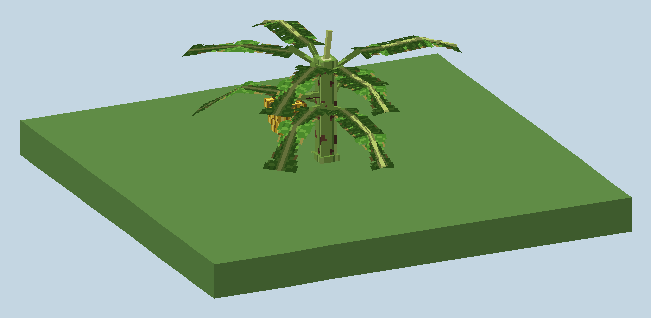
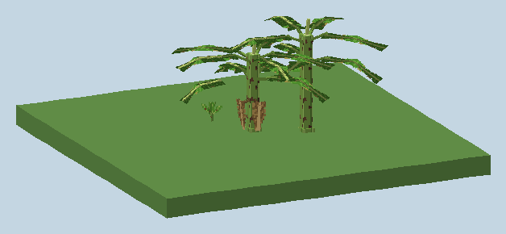

# Banana plant

**English** | [Português](banana.pt-BR.md)

A banana is not a tree. It is a giant herb: what looks like a trunk is a **pseudostem** of tightly rolled leaf sheaths, every stem fruits **once** and then dies, and the plant lives on through the **suckers** its underground rhizome keeps sending up. Farmer+ builds the plant exactly like that.

 

*Renders of plants generated by the game and read back from the saved world (`python art/preview_world_models.py`).*

## Real plant → game

| | Real plant | In game |
|---|---|---|
| Height to the crown | 2.5–3 m (Cavendish, Prata-Anã); 4–8 m wild | 3–4 blocks (orchard), 4–6 blocks (wild) |
| Pseudostem | 22–30 cm wide, a little wider at the base | 6 px column with an 8 px base |
| Leaves | 12–18 alive, blade 1.5–3 m × 0.4–0.9 m, petiole 0.6 m | 8–10 leaves, each about 3 blocks long and 13 px wide |
| Crown | Young leaves rise from the top, older ones arch over, dead ones hang brown on the stem | Upright young tier, arching mature tier, 0–2 dry hanging leaves |
| Bunch | One per stem, 8–12 hands, 20–25 kg, hangs under the crown with a purple male bud | One bunch block under the crown with hands and a purple bud |
| Cycle | Flowers ~6 months after planting, ripe ~4.5 months later, then a follower sucker replaces the stem | About an hour of play from sucker to ripe bunch, then a follower sucker |

Sources: [ProMusa — morphology of the banana plant](https://www.promusa.org/Morphology+of+banana+plant), [Embrapa field trials of Prata-Anã and other cultivars](https://www.alice.cnptia.embrapa.br/alice/bitstream/doc/653602/1/Avaliacao-de-cultivares-e-hibridos-de-bananeira-no-reconcavo-baiano..pdf), [CIRAD — Cavendish cultivars](https://revues.cirad.fr/index.php/fruits/article/download/35482/36857/40496), [Kew POWO — *Musa acuminata* subsp. *microcarpa*](https://powo.science.kew.org/taxon/urn:lsid:ipni.org:names:60457966-2/general-information), [*Musa acuminata* on Wikipedia](https://en.wikipedia.org/wiki/Musa_acuminata).

## Blocks

| Block | What it is |
|---|---|
| `banana_sapling` (Banana Sucker) | A young sucker. Grows into a plant (≈1 in 8 random ticks per stage, light 9+). Drops itself. |
| `banana_stem` (Pseudostem) | Works out its own `segment`: `base` (wider foot), `middle` and `crown` (leaf sheaths and the rolled "cigar" leaf). Needs dirt-like ground or another stem below; cutting it drops everything above. Drops string a third of the time — banana fibre. |
| `banana_leaf` | A giant leaf built from segments: `direction` (8 directions), `segment` (`0` petiole and blade base, `1` blade, `2` drooping tip; diagonal leaves use `0` and `2`) and `age` (`young`, `mature`, `dry`). Removing a segment drops the rest of that leaf, and cutting the stem drops all of its leaves. No collision. Only shears or Silk Touch keep it. |
| `banana_bunch` | Hangs beside the stem under the crown. `stage`: `0` purple bud, `1` flowering with small hands, `2` green bunch, `3` ripe. |

## Life cycle

1. **Sucker → plant.** A sucker grows into a plant with an upright young tier, an arching mature tier and, on taller plants, a few dry leaves hanging on the stem.
2. **Flowering.** The crown sends out one bunch (≈1 in 20 random ticks) beside the stem, just under the crown, on any free side.
3. **Fruit.** The bunch goes bud → flowering → green → ripe (≈1 in 6 per stage; bone meal advances one stage). A ripe bunch stays until it is picked.
4. **Harvest.** Right-click a ripe bunch for **6–10 bananas**. Breaking a ripe bunch drops them too; earlier stages drop nothing.
5. **Die-back.** Once its bunch is gone (picked, broken or lost), the stem is spent: it never flowers again and soon collapses (≈1 in 6 random ticks), and a **follower sucker** takes its place on the same spot.
6. **Clumps.** A living plant also sends up new suckers within 2 blocks (≈1 in 40 random ticks), up to 4 stems and suckers per clump.

With the default `random_tick_speed`, a sucker becomes a plant with a ripe bunch in about an hour.

## Banana

4 hunger, 0.4 saturation; villagers eat it; compostable.

## Wild plants

Clumps of one tall plant plus 2–4 suckers or young plants grow in jungles, sparse jungles and bamboo jungles (`farmerplus:has_banana_plants`), about one clump every four chunks; a third of them already carry a bunch.

## Tuning

`data/farmerplus/worldgen/feature/banana_plant.json` (growth from a sucker) and `wild_banana_clump.json` use the `farmerplus:banana_plant` feature (`content/banana/BananaPlantFeature`):

| Field | Meaning |
|---|---|
| `height` | Pseudostem height in blocks (2–8) |
| `leaves` | Number of living leaves (2–16), shared between the young and mature tiers |
| `suckers` | Extra suckers or young plants around the plant (0–6) |
| `bunch_chance` | Chance that the plant already carries a bunch (0–1) |

## Art

Models and placeholder textures come from `python art/banana_art.py`; textures it finds are never overwritten. The art backlog is [art task 0006](art-tasks/0006-banana-plant.md).
