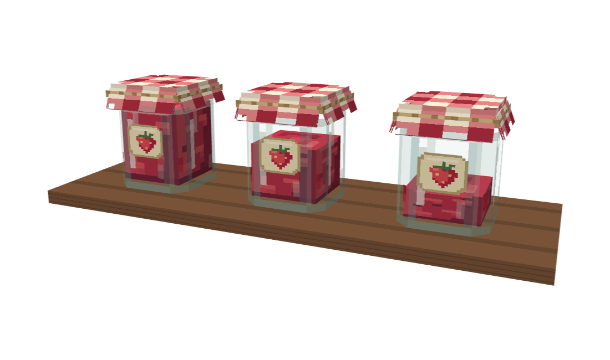
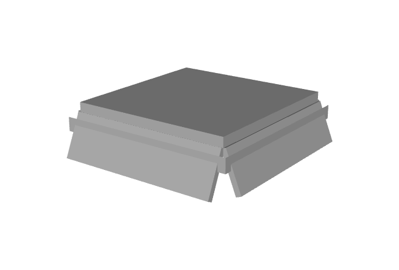
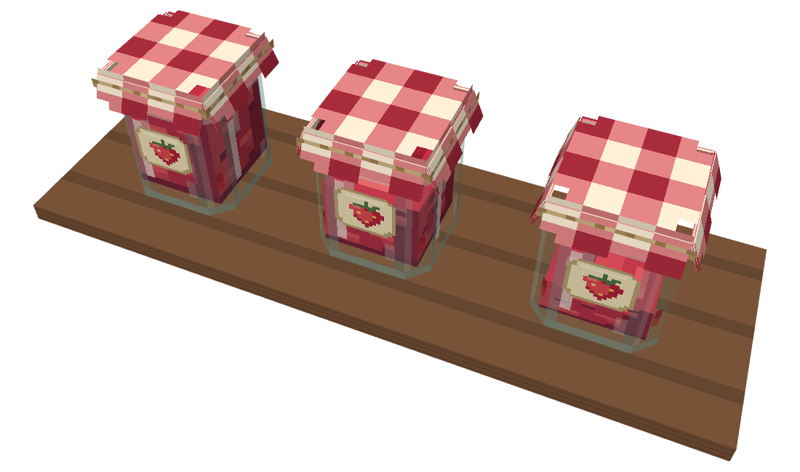
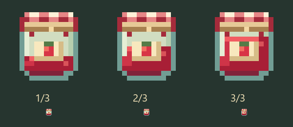

# Visual da geleia de morango

[English](strawberry-jam-visuals.md) | **Português**

Os três níveis de porções usam pixel art original nativa em 16×16 e projetos Java Block/Item editáveis feitos pelo MCP do Blockbench. Cada modelo tem doze elementos e cinquenta e uma faces. Geometria, texturas, ids e o mapeamento existente de porções/direção são compartilhados pelos loaders.

## Geometria e materiais

Quatro pares de faces de vidro formam um corpo com oito lados apoiado em Y=0, com as faces inferiores integradas nos mesmos elementos. O vidro continua com seis unidades de largura; o tecido abre para cerca de sete unidades. A altura total continua em oito unidades, portanto `JamJarBlock.SHAPE` permanece `Block.column(6.0, 0.0, 8.0)`.

Um volume sólido de geleia cabe dentro dos chanfros do vidro. Sua altura passa de cerca de um terço para dois terços e cheio. Os grupos de pixels deixam a superfície levemente irregular. Sombras vermelhas profundas, sementes escuras esparsas e pedaços de fruta mais claros ficam atrás do vidro. Uma pequena mancha aparece num chanfro acima do nível mais baixo.

A tampa xadrez tem um topo fino e quatro partes sólidas de tecido presas às suas quatro bordas. Cada parte tem espessura e gira para fora num ângulo diferente, formando uma saia conectada. A dobra solta e a bainha em caixa foram removidas. A faixa de barbante em relevo passa pelos quatro lados e tem 0,5 unidade de espessura vertical, 2,5 vezes a espessura anterior. O rótulo creme voltado ao norte é uma face recortada logo à frente do vidro, com um desenho de morango e sem texto.

O vidro é a única textura com alfa parcial. O objeto de textura do Minecraft 26.3 `{"sprite": "farmerplus:block/strawberry_jam_glass", "force_translucent": true}` mantém o vidro no material translúcido, enquanto geleia, tecido e rótulo continuam opacos ou recortados. Não há renderizador próprio, block entity, atualização por tick nem novo registro. O script de exportação configura a ordem de profundidade dos materiais da prévia depois de salvar; esse ajuste é apenas do editor.

## Contextos do item

`items/strawberry_jam.json` continua selecionando a porção por `minecraft:block_state`. Cada nível então usa `minecraft:display_context`: o inventário seleciona seu ícone 16×16, enquanto mão, item jogado, moldura e demais contextos usam o modelo de bloco 3D correspondente. Os transforms de exibição ficam salvos nos três projetos e JSONs exportados.

## Fontes e reprodução

- `art/strawberry_jam.py`: desenho dos pixels, entradas dos modelos, ícones e definições de contexto.
- `art/model-inputs/strawberry_jam_1.json` até `_3.json`: entradas da geometria.
- `art/blockbench/strawberry_jam_1.bbmodel` até `_3.bbmodel`: projetos editáveis, cada um com quatro atlas 16×16 embutidos.
- `art/export_strawberry_jam.js`: `exportStrawberryJam(root)` importa e exporta pelo MCP do Blockbench.
- `art/preview_strawberry_jam.js`: `previewStrawberryJam(root)` monta uma cena temporária de mesa e renderiza frente, cima e trás.

Rode `python art/strawberry_jam.py`, exporte pelo MCP e execute `./gradlew build` e `python art/validate_wheat_art.py`. O validador verifica referências, limites, texturas embutidas portáveis, alturas reais do recheio, rótulos ao norte, seleção por contexto e recursos idênticos nos jars dos três loaders.

## Verificação

O build e o validador de arte passaram. O NeoForge carregou os recursos atuais e criou os atlas de blocos e itens sem avisos de modelo ou textura do Farmer+. A comparação dos bytes em execução e os hashes ficam em `build/art/validation/strawberry-jam-resource-load.json`.

As imagens da mesa são renderizações do Blockbench. A inspeção manual de três potes colocados dentro do Minecraft ainda está pendente; carregar os recursos não comprova esse aceite visual.
