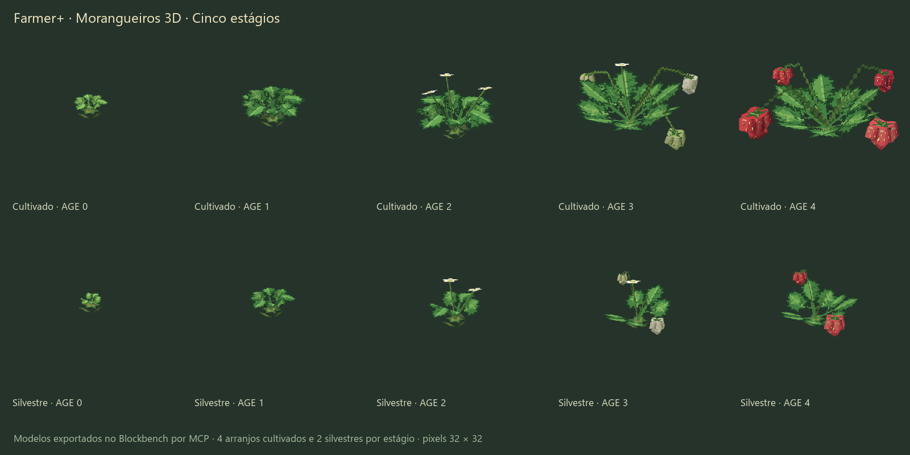
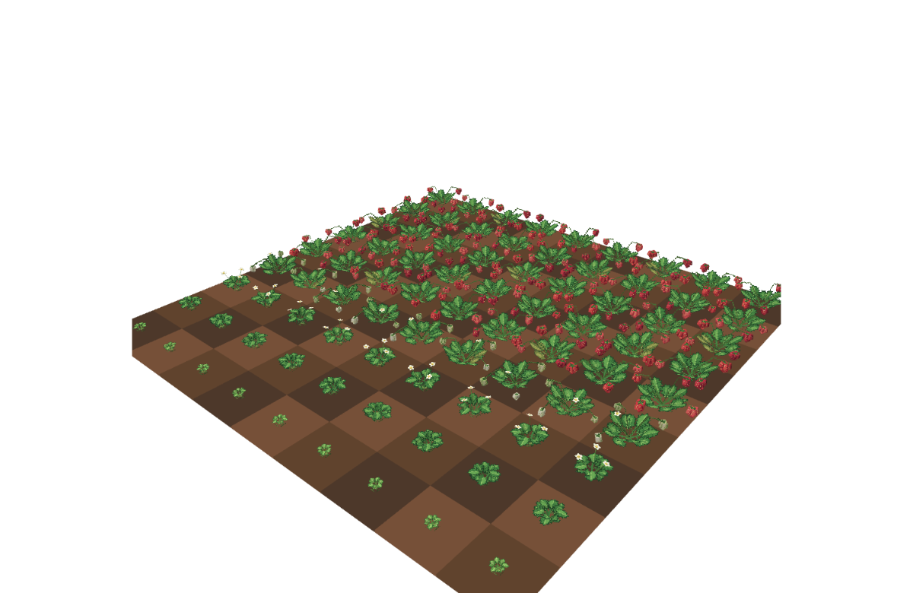

# Modelos visuais dos morangos

**English** | [Português](strawberry-visuals.md)

A tarefa 0003 substitui os modelos provisórios em cruz por trinta projetos nativos Java Block/Item do Blockbench: cinco idades cultivadas com quatro arranjos diferentes cada, e cinco idades silvestres com dois arranjos cada. O blockstate cultivado tem dezesseis alternativas com pesos iguais por idade; o silvestre tem oito. Os arranjos mudam ângulos, alturas e comprimentos das folhas, posições dos frutos, tamanhos e cores.

| Idade | Elementos cultivados | Elementos silvestres | Conteúdo |
|---|---:|---:|---|
| 0 | 7 | 5 | Coroa baixa e folhas trifoliadas jovens |
| 1 | 11 | 7 | Roseta maior com segmentos de arco conectados |
| 2 | 15 | 9 | Três flores no cultivado, duas no silvestre |
| 3 | 20 | 12 | Três frutos verdes/brancos no cultivado ou dois no silvestre, uma flor |
| 4 | 20 | 11 | Quatro frutos maduros no cultivado ou dois menores no silvestre |

Cada morango tem três cuboides sólidos: dois ombros inclinados separadamente e uma ponta orientada por um vértice. A composição das rotações Euler forma uma ponta em três dimensões, sem fundo reto. O cálice ocupa as faces superiores; sementes amarelas e brilhos em grupos de pixels aparecem nas laterais. Há materiais vermelho vivo, rosado e vermelho mais escuro, além de quatro fatores de tamanho. Frutos verdes usam paletas verdes, creme e quase brancas. Planos finos de pedúnculos ramificados mantêm o modelo maduro em vinte elementos. As folhas têm silhueta serrilhada, nervuras centrais e laterais e verso mais claro. Não foi acrescentado renderizador próprio, block entity ou atualização visual por tick.

A coroa tem apenas 0,38 unidade de altura, silhueta transparente irregular e vai de Y=-1 a -0,62. Os pecíolos começam dentro dela em Y=-0,65. Frutos maduros ficam acima de Y=0,25, livres tanto da terra arada em Y=-1 quanto de blocos vizinhos com superfície em Y=0. Os trinta arranjos são conferidos. O toco quadrado anterior e as cinco texturas provisórias de estágio sem referências foram removidos.

Os onze atlas de bloco e o sprite do item são pixel art original RGBA em 32×32, com alpha binário. As texturas são desenhadas com polígonos e traços de pixels em `art/strawberries.py`. Três paletas de folha e um atlas separado de verso mantêm a mesma silhueta; atlas de cores de fruto variam o material sem substituir as diferenças de geometria dos arranjos. O item tem formato de coração, sementes, cálice e haste curta. IDs e caminhos existentes do item/modelos foram preservados.

## Fontes e reprodução

Os fontes são `art/blockbench/strawberry_plant_stage<idade>[_variantN].bbmodel` e `art/blockbench/wild_strawberries_stage<idade>[_variant1].bbmodel`. Cada projeto incorpora suas texturas em 32×32. Todos os modelos finais são importados, salvos e exportados no Blockbench 5.2.2 por seu plugin MCP. As rotações Euler exportadas são comparadas à entrada; uma rotação de um eixo pode ser serializada em `axis`/`angle` sem mudar o resultado.

1. Execute `python art/strawberries.py` para desenhar texturas, entradas de geometria e blockstates.
2. Pelo `risky_eval` do MCP conectado ao Blockbench, carregue `art/export_strawberries.js` e execute `await exportStrawberries(root)`, passando a raiz absoluta do repositório. `previews=false` pula as capturas, mantendo o salvamento e a exportação nativos.
3. Execute `python art/validate_strawberries.py`. Se a geometria mudar, compare as dimensões de seleção relatadas com os arrays estáticos em Java antes de compilar.
4. Execute `./gradlew build` e `python art/validate_wheat_art.py`; o segundo inclui as verificações dos morangos.
5. Execute `./gradlew :neoforge:runClient` e confira os modelos e o log.

`art/blockbench_mcp.py` é um cliente HTTP pequeno para o transporte MCP local configurado em `http://localhost:3000/bb-mcp`, quando a ferramenta nomeada não aparece na sessão. Ele chama a ferramenta MCP real `risky_eval` no Blockbench; não fabrica projetos nativos por fora do aplicativo.

`art/validate_strawberries.py` confere limites de elementos, arranjos distintos, pesos/rotações dos blockstates, frutos sólidos com seis faces, ombros inclinados separadamente, contato entre volumes por eixos de separação, encontro entre hastes e cálices, distância do solo, limites dos modelos, pixels exatos das texturas incorporadas e contornos estáticos de seleção. Hashes e medições atuais ficam em `build/art/validation/strawberries.json`. A exportação MCP é registrada em `build/art/validation/strawberry-blockbench-export.json`.

## Contornos de seleção

`StrawberryPlantBlock.SHAPES` foi alterado. As primeiras idades ficaram menores e mais baixas; as plantas com frutos ultrapassam o contorno antigo de quatorze unidades. Todos os contornos começam em Y=-1. O silvestre agora tem seu próprio array menor de cinco contornos, em vez de herdar as dimensões cultivadas. São contornos estáticos de seleção; crescimento e colisão não ganharam mecânicas novas. Reinicie o cliente para carregar as mudanças Java; F3+T só recarrega recursos visuais.

## Verificação e limites

`art/preview_strawberries.js` renderiza no Blockbench um campo com 81 posições, usando todas as idades e arranjos. Também produz vistas na altura dos olhos, a aproximadamente cinco e vinte blocos da borda próxima. São **renderizações do Blockbench, não capturas do Minecraft**. O agente não inspecionou manualmente o campo 9×9 final nas duas distâncias dentro do Minecraft e não fez benchmark de FPS. Essa conferência manual de aceitação permanece aberta.

