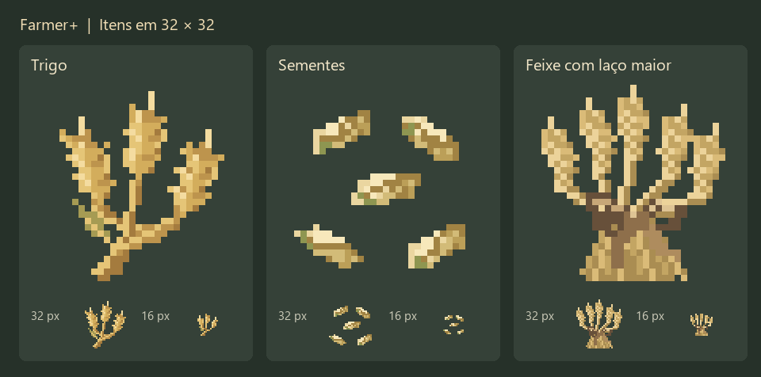

# Realistic Vanilla+ wheat

**English** | [Português](wheat-visuals.pt-BR.md)

The wheat overhaul replaces vanilla wheat visuals with original **32×32 pixel art**: tapered stalks, elongated ears built from small alternating grain clusters, short awns and a few restrained arching leaves. Gameplay is untouched — growth, hydration, bone meal, drops, outline and collision are vanilla.


## Growth stages

| AGE | Appearance | Model upper Y |
|---|---|---|
| 0 | Small rooted sprouts | 15 |
| 1 | Longer young blades | 15 |
| 2 | Denser tillers | 15 |
| 3 | Long leaves, emerging stalks | 15 |
| 4 | Green developing ears | 17 |
| 5 | Taller stalks, yellow-green heads | 19 |
| 6 | Four developing ears, six modelled leaves | 18 / 20 / 21 / 24 |
| 7 | Golden ears and straw, six modelled leaves | 19 / 21 / 23 / 26 |

Coordinates use 16 units per block. Every model starts at Y=−1 to meet the farmland surface. Mature crops reach 1.25–1.69 blocks visually, but the extra height is not a second block: harvest by targeting the original lower block.

Colour follows maturity: green through AGE 4, yellow-green at AGE 5, olive/straw at AGE 6, golden straw at AGE 7.

## Variation

Each age has four sprite layouts (`wheat_stageN`, `_alternate`, `_variant2`, `_variant3`) combined into four models, each with four Y rotations. The blockstate picks one of 16 equally weighted alternatives through vanilla's position-based model selection — stable per block, no tick work, no extra dependencies.


## Geometry budget

| Model | Elements | Faces |
|---|---|---|
| AGE 0–5 crop | 4 double-sided planes | 8 |
| AGE 6–7 crop | 4 planes + 6 two-segment leaves = 16 | 32 |
| Wheat Sheaf | 8 stalk/head planes + 1 core + 15 cord cuboids = 24 | 96 |

Vanilla crops use 8 faces, so mature wheat costs more geometry. AGE 0–5 child models only remap textures and inherit their parent geometry.

## Sheaf and items

The sheaf has a pinched waist, dense cut stalks and a solid 3D cord: a closed four-sided wrap, two open bow loops, a knot and two hanging ends. It stays inside the existing 12×16×12 outline, so `WheatSheafBlock` needs no shape change.

In inventories the sheaf uses a dedicated 32×32 icon: `items/wheat_sheaf.json` selects `farmerplus:item/wheat_sheaf` for the `gui` display context and falls back to the 3D block model everywhere else.


Flour, dough, porridge, wheat and seeds were redrawn at 32×32. Registry ids, recipes and food values are unchanged.



## Resource loading

```text
minecraft:wheat age=0..7
  assets/minecraft/blockstates/wheat.json
    minecraft:block/wheat_stageN
      farmerplus:block/wheat_stageN
    farmerplus:block/wheat_stageN_variant1..3
      farmerplus:block/wheat_stageN
```

The base stage models keep the vanilla `minecraft:block/wheat_stageN` texture paths; added combinations live under `farmerplus:block/…`. Everything ships from `common/src/main/resources`, so Fabric, NeoForge and Forge get identical files. Player resource packs keep normal priority and can override any of these files.

## Optional standalone resource pack

```bash
./gradlew wheatVisualPack
```

Produces `build/resourcepacks/FarmerPlus-Detailed-Vanilla-Wheat-26.3.zip` (also built by `./gradlew build`). It contains only the wheat visuals, works without the mod, and has no recipes, code or mod items. Put it in `resourcepacks` and move it above other packs.

## Editing the art

| Path | Purpose |
|---|---|
| `art/blockbench/wheat_stage*.bbmodel`, `wheat_sheaf.bbmodel` | Editable Blockbench projects with embedded textures |
| `art/model-inputs/` | Geometry inputs for the Blockbench export |
| `art/wheat_32.py`, `art/build_wheat_art.py` | Pixel authoring and PNG generation (Pillow) |
| `art/export_blockbench.js` | Imports into Blockbench via MCP, saves `.bbmodel`, exports 26.3 JSON |
| `art/preview_wheat_field.js` | Renders a 12×12 field preview in Blockbench |
| `art/inspect_leaf_clearance.js`, `art/inspect_sheaf_binding.js` | Geometry checks in Blockbench |
| `art/validate_wheat_art.py` | Validates sizes, alpha, palettes, UVs, references, jar contents and the standalone pack |

Generated previews and reports go to `build/art/` and are not committed.

Rebuild order (Blockbench open with the MCP plugin):

1. `python art/build_wheat_art.py`
2. Through MCP: `exportWheatArt(root)` from `art/export_blockbench.js`
3. Through MCP: `inspectLeafClearance(root)` and `inspectSheafBinding(root)`
4. `./gradlew build`
5. `python art/validate_wheat_art.py`
