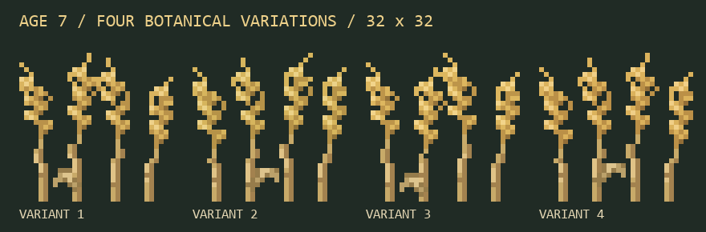
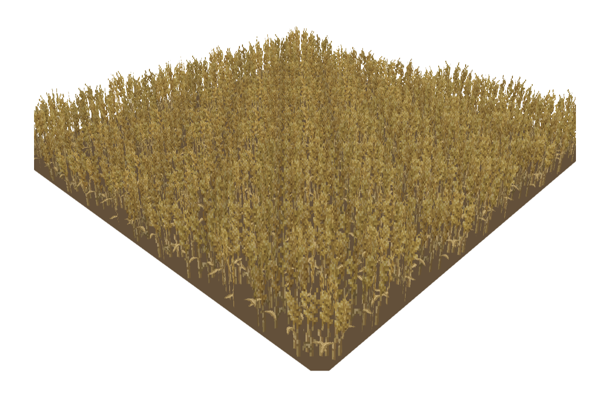
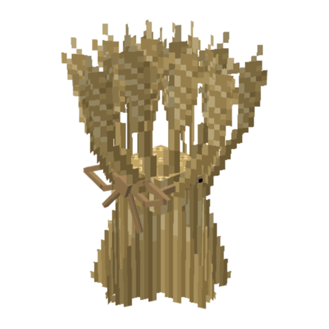
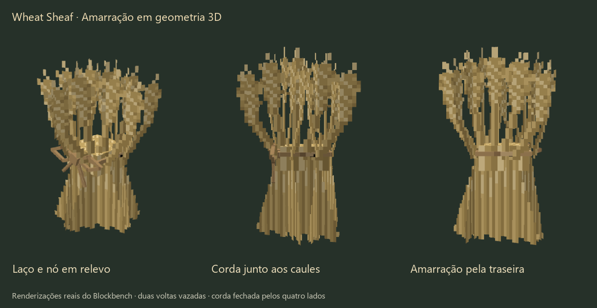
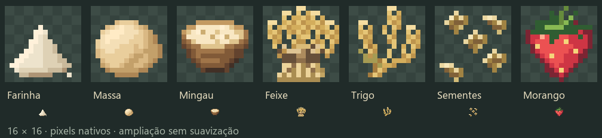

# Trigo Vanilla+ realista

[English](wheat-visuals.md) | **Português**

A reformulação do trigo substitui o visual do trigo vanilla por **pixel art original em 16×16**: caules afunilados, espigas alongadas formadas por pequenos grupos alternados de grãos, barbas curtas e poucas folhas arqueadas. A jogabilidade não muda — crescimento, hidratação, farinha de osso, drops, contorno e colisão são os do vanilla.


## Estágios de crescimento

| AGE | Aparência | Y superior do modelo |
|---|---|---|
| 0 | Brotos pequenos enraizados | 15 |
| 1 | Folhas jovens mais longas | 15 |
| 2 | Perfilhos mais densos | 15 |
| 3 | Folhas longas, caules surgindo | 15 |
| 4 | Espigas verdes em formação | 17 |
| 5 | Caules mais altos, espigas verde-amareladas | 19 |
| 6 | Quatro espigas em formação, seis folhas modeladas | 18 / 20 / 21 / 24 |
| 7 | Espigas e palha douradas, seis folhas modeladas | 19 / 21 / 23 / 26 |

As coordenadas usam 16 unidades por bloco. Todo modelo começa em Y=−1 para encostar na terra arada. O trigo maduro chega visualmente a 1,25–1,69 bloco, mas a altura extra não é um segundo bloco: colha mirando o bloco inferior original.

A cor acompanha o amadurecimento: verde até AGE 4, verde-amarelado em AGE 5, oliva/palha em AGE 6, palha dourada em AGE 7.

## Variação

Cada estágio tem quatro layouts de sprite (`wheat_stageN`, `_alternate`, `_variant2`, `_variant3`) combinados em quatro modelos, cada um com quatro rotações em Y. O blockstate escolhe uma de 16 alternativas com o mesmo peso pela seleção de modelo por posição do vanilla — estável por bloco, sem trabalho por tick, sem dependências extras.





## Orçamento de geometria

| Modelo | Elementos | Faces |
|---|---|---|
| Trigo AGE 0–5 | 4 planos com duas faces | 8 |
| Trigo AGE 6–7 | 4 planos + 6 folhas de dois segmentos = 16 | 32 |
| Feixe de Trigo | 8 planos de caule/espiga + 1 núcleo + 15 cubos de corda = 24 | 96 |

O trigo vanilla usa 8 faces, então o trigo maduro custa mais geometria. Os modelos filhos de AGE 0–5 só trocam texturas e herdam a geometria do pai.

## Feixe e itens

O feixe tem cintura apertada, caules cortados densos e uma corda 3D sólida: uma volta fechada nos quatro lados, dois laços vazados, um nó e duas pontas penduradas. Ele cabe no contorno atual de 12×16×12, então o `WheatSheafBlock` não precisa mudar o shape.

No inventário o feixe usa um ícone próprio em 16×16: `items/wheat_sheaf.json` escolhe `farmerplus:item/wheat_sheaf` no contexto `gui` e usa o modelo 3D do bloco em todos os outros.





Farinha, massa, mingau, trigo e sementes são desenhados em grades nativas de 16×16, mantendo as paletas quentes Vanilla+ e simplificando as pequenas marcações. O morango e o ícone de inventário do feixe também usam 16×16. Ids de registro, receitas e valores de comida não mudaram.



## Carregamento de recursos

```text
minecraft:wheat age=0..7
  assets/minecraft/blockstates/wheat.json
    minecraft:block/wheat_stageN
      farmerplus:block/wheat_stageN
    farmerplus:block/wheat_stageN_variant1..3
      farmerplus:block/wheat_stageN
```

Os modelos base de cada estágio mantêm os caminhos de textura vanilla `minecraft:block/wheat_stageN`; as combinações extras ficam em `farmerplus:block/…`. Tudo sai de `common/src/main/resources`, então Fabric, NeoForge e Forge recebem os mesmos arquivos. Resource packs do jogador mantêm a prioridade normal e podem substituir qualquer um desses arquivos.

## Resource pack avulso opcional

```bash
./gradlew wheatVisualPack
```

Gera `build/resourcepacks/FarmerPlus-Detailed-Vanilla-Wheat-26.3.zip` (o `./gradlew build` também gera). Ele tem só o visual do trigo, funciona sem o mod e não traz receitas, código nem os itens do mod. Coloque em `resourcepacks` e mova para cima dos outros packs.

## Editando a arte

| Caminho | Uso |
|---|---|
| `art/blockbench/wheat_stage*.bbmodel`, `wheat_sheaf.bbmodel` | Projetos editáveis do Blockbench com texturas embutidas |
| `art/model-inputs/` | Geometria de entrada para a exportação do Blockbench |
| `art/wheat_32.py`, `art/build_wheat_art.py`, `art/item_pixels.py` | Desenho dos blocos e itens nativos em 16×16 e geração dos PNGs (Pillow) |
| `art/export_blockbench.js` | Importa no Blockbench via MCP, salva `.bbmodel` e exporta JSON do 26.3 |
| `art/preview_wheat_field.js` | Renderiza a prévia de um campo 12×12 no Blockbench |
| `art/inspect_leaf_clearance.js`, `art/inspect_sheaf_binding.js` | Verificações de geometria no Blockbench |
| `art/validate_wheat_art.py` | Valida tamanhos, alpha, paletas, UVs, referências, conteúdo dos jars e o pack avulso |

Prévias e relatórios gerados vão para `build/art/` e não entram no git.

Ordem para regerar (Blockbench aberto com o plugin MCP):

1. `python art/build_wheat_art.py`
2. Via MCP: `exportWheatArt(root)` de `art/export_blockbench.js`
3. Via MCP: `inspectLeafClearance(root)` e `inspectSheafBinding(root)`
4. `./gradlew build`
5. `python art/validate_wheat_art.py`

Para atualizar somente os ícones dos itens, rode `python art/item_pixels.py`; isso preserva todos os modelos e texturas de bloco. O script também atualiza a prévia dos itens.
